# Manual de usuario — Mantas Guajiras

Guía para **vendedores** y **administradores**. Las imágenes son de la app real, tomadas por el ensayo automático de aceptación (`frontend/e2e/acceptance.e2e.cjs`). En el celular se ve como en las imágenes angostas; en el computador, como en las anchas.

---

## Contenido

- [1. Antes de empezar](#1-antes-de-empezar)
- [2. Vender](#2-vender)
- [3. Vender sin conexión](#3-vender-sin-conexión)
- [4. Mantas personalizadas](#4-mantas-personalizadas)
- [5. Inventario](#5-inventario)
- [6. Producción](#6-producción)
- [7. Mi perfil](#7-mi-perfil)
- [8. Productos (administrador)](#8-productos-administrador)
- [9. Historial de ventas (administrador)](#9-historial-de-ventas-administrador)
- [10. Compras (administrador)](#10-compras-administrador)
- [11. Usuarios (administrador)](#11-usuarios-administrador)
- [12. Mensajes y qué hacer](#12-mensajes-y-qué-hacer)

---

## 1. Antes de empezar

### Qué puede hacer cada uno

| | Vendedor | Administrador |
| --- | :---: | :---: |
| Vender (también sin conexión) | ✔ | ✔ |
| Mantas personalizadas: registrar y cobrar abonos | ✔ | ✔ |
| Ver inventario y su historial | ✔ | ✔ |
| Ajustar inventario por conteo (con motivo) | ✔ | ✔ |
| Registrar producción | ✔ | ✔ |
| Consultar productos y precios | ✔ | ✔ |
| Crear, editar o desactivar productos | | ✔ |
| Ver el historial de ventas con montos | | ✔ |
| Registrar compras | | ✔ |
| Crear usuarios, activar cuentas y restablecer contraseñas | | ✔ |

Si un vendedor abre una sección de administrador, ve **"Sección restringida"**. El servidor también lo impide, aunque alguien intente entrar por otro camino.

### Entrar

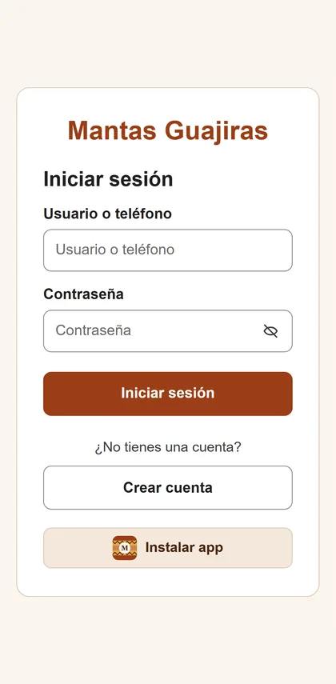

1. Escribe tu **usuario o tu teléfono** y tu **contraseña** (de 4 a 12 caracteres).
2. Pulsa **Iniciar sesión**. La sesión dura **12 horas**: toda la jornada.
3. **¿Primera vez?** Pulsa *Crear cuenta*. La cuenta queda **esperando aprobación** hasta que un administrador la active.

> Si escribes mal la contraseña **5 veces seguidas**, ese usuario queda bloqueado **15 minutos**. Así se frena a quien intente adivinarla.

### Instalar la app en el celular

Pulsa **Instalar app** (abajo en el menú). Queda como un ícono más del celular, abre a pantalla completa y **funciona sin internet** para vender.

### El menú en el celular

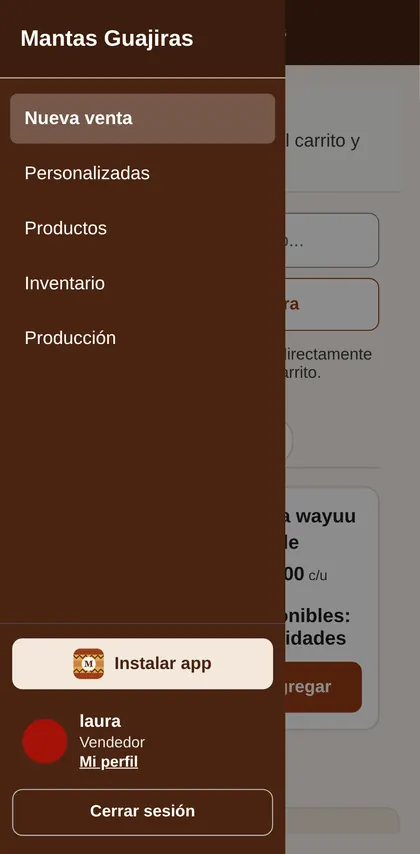

Pulsa **☰ Menú** arriba a la izquierda. Abajo están tu nombre, *Mi perfil* y **Cerrar sesión**.

Los datos se **actualizan solos** cada minuto y al volver a la app. No hace falta recargar.

---

## 2. Vender

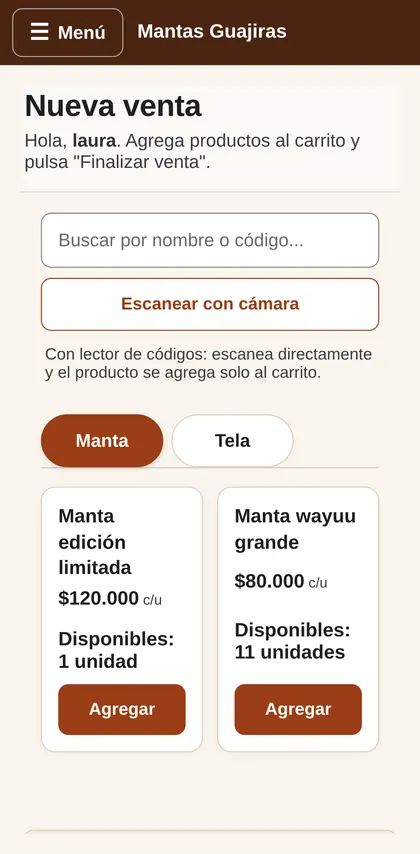 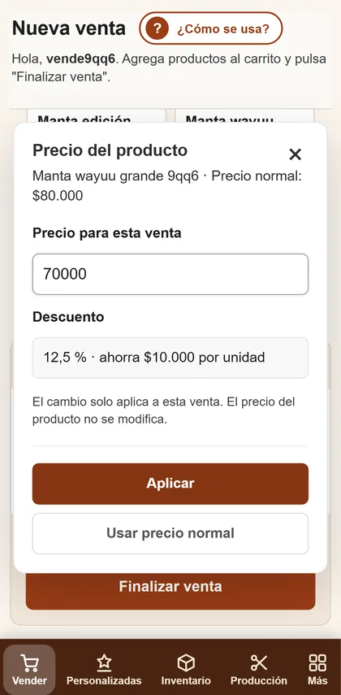 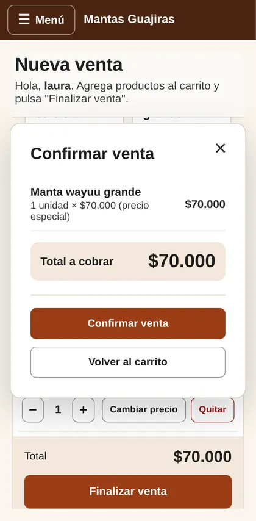

1. En **Nueva venta**, elige la pestaña (**Manta** o **Tela**) o busca el producto por nombre o código. Con lector de códigos, escanea: el producto entra solo al carrito. En el celular puedes pulsar **Escanear con cámara**.
2. Pulsa **Agregar**. En el carrito:
   - **− / +** cambian la cantidad de mantas.
   - En las **telas** escribes los **metros**. Se aceptan decimales, por ejemplo 2,5.
   - **Quitar** saca el producto del carrito.
3. **Precio especial** (por ejemplo, $80.000 → $70.000):
   1. Pulsa **Cambiar precio** y escribe el precio para esta venta.
   2. La app muestra el descuento: *"12,5 % · ahorra $10.000 por unidad"*.
   3. Pulsa **Aplicar**.

   El precio del producto **no cambia**: solo esta venta. **Usar precio normal** lo deshace.
4. Pulsa **Finalizar venta**, revisa el resumen y pulsa **Confirmar venta**. Aparece *"La venta se guardó correctamente."*, el inventario baja y la venta queda a tu nombre.

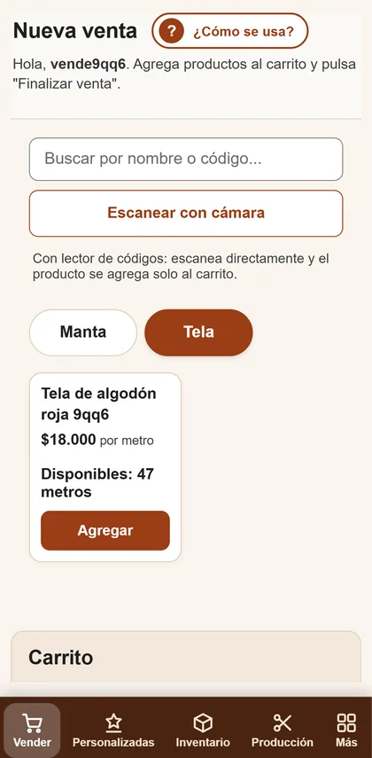

Las ventas **no se pueden editar ni borrar** después de registrarse, para que el historial sea confiable. Si te equivocaste, avisa a un administrador para que ajuste el inventario con el motivo.

### Si no hay existencias

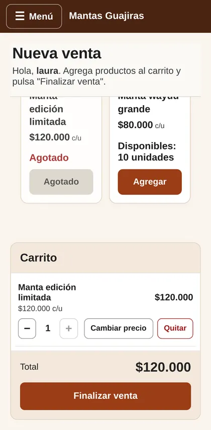

- Un producto sin existencias aparece como **Agotado** y no se puede agregar.
- Si otra persona vendió la última unidad mientras tenías el carrito abierto, al confirmar aparece *"No hay suficiente inventario de … Disponible: 0"*. La venta **no** se registra, el inventario **nunca** queda negativo y el carrito se conserva para que lo corrijas.

---

## 3. Vender sin conexión

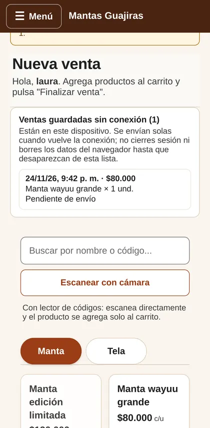

Si se va el internet (o el servidor no responde), **sigue vendiendo igual**:

1. Arriba aparece *"Vendiendo sin conexión"*, con los precios y las existencias de la última vez que hubo conexión.
2. Al confirmar, la app dice *"No hay conexión con el servidor: la venta quedó guardada en este dispositivo"*.
3. La venta aparece en **"Ventas guardadas sin conexión"** como *Pendiente de envío*.
4. Cuando vuelve la conexión **se envía sola**:
   - con la **hora real** en que la hiciste;
   - a **tu nombre**;
   - **una sola vez**, aunque el internet se corte en mitad del envío.
5. En el historial del administrador queda marcada **"Hecha sin conexión"**.

**Importante:**

- **No cierres sesión ni borres los datos del navegador** mientras haya ventas en esa lista. Si intentas cerrar sesión con ventas pendientes, la app te avisa.
- Si al enviarla el servidor la **rechaza** (por ejemplo, porque mientras tanto se agotó el producto), queda marcada con el motivo:
  - **Reintentar** la vuelve a enviar, después de que un administrador ajuste el inventario;
  - **Descartar** la elimina, y entonces **no** queda registrada.
- Sin conexión solo se puede **vender**. Compras, producción, ajustes y personalizadas necesitan conexión.

---

## 4. Mantas personalizadas

Encargos de clientes con diseño propio, que se pagan en abonos.

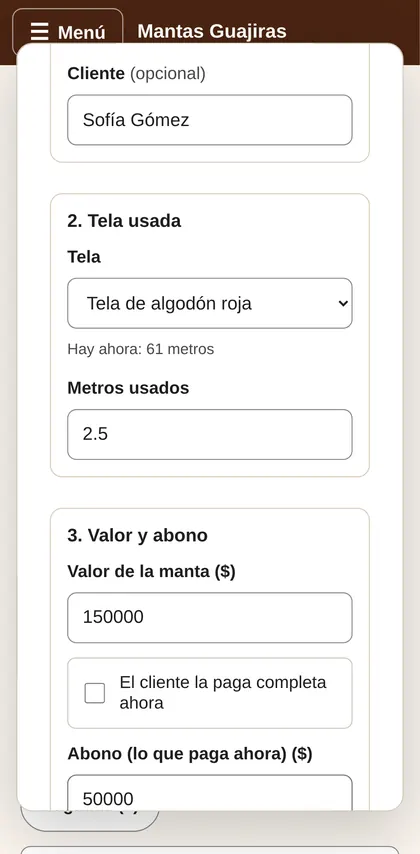 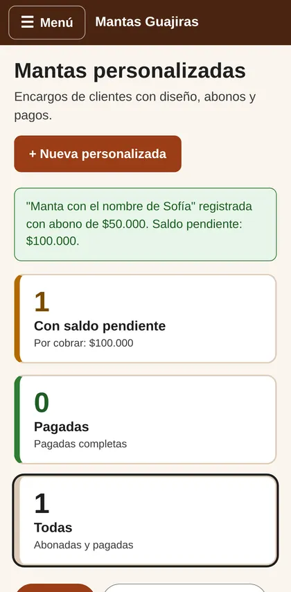

1. **+ Nueva personalizada**. Completa:
   - el nombre de la manta;
   - el cliente (opcional);
   - la **tela usada y los metros**, que se descuentan del inventario de tela;
   - el **valor** y el **abono** que paga ahora. Si paga todo de una vez, marca *"El cliente la paga completa ahora"*.
2. Pulsa **Registrar personalizada**. Aparece, por ejemplo, *"… registrada con abono de $50.000. Saldo pendiente: $100.000."*

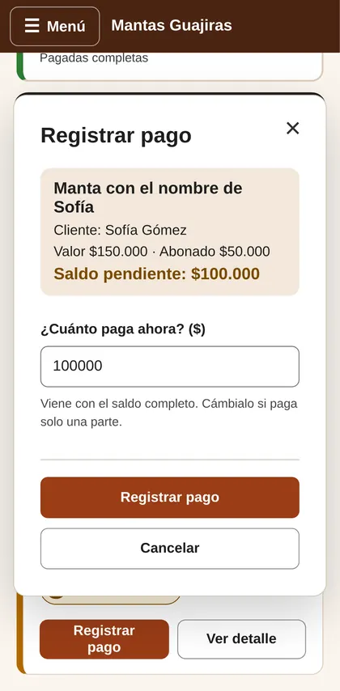 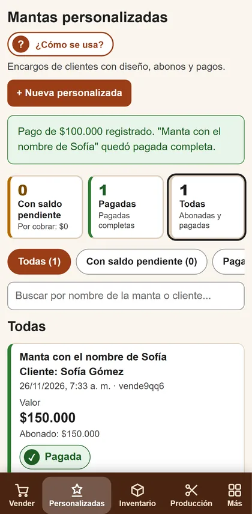

3. Cuando el cliente vuelve a pagar: **Registrar pago** en esa manta. La app propone el saldo completo; cámbialo si paga solo una parte. Un pago no puede superar el saldo.
4. Al completar el pago queda **Pagada**. *Ver detalle* muestra todos los pagos con fecha y quién los recibió.

La manta personalizada se entrega al cliente: **no** suma al inventario de mantas.

---

## 5. Inventario

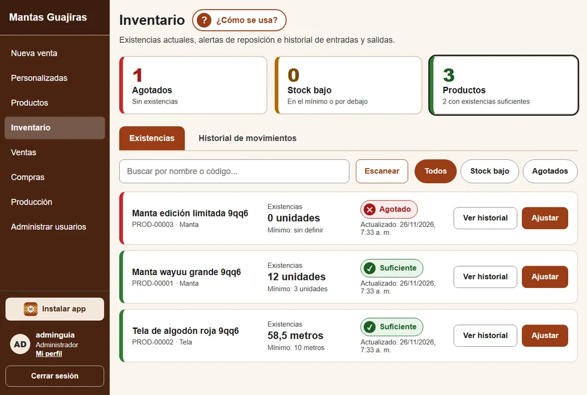

Cada producto aparece con sus existencias y un estado: **Suficiente**, **Stock bajo** (en el mínimo o por debajo) o **Agotado**. Las tarjetas de arriba filtran por estado.

### Ajustar por conteo físico

Cuando cuentes y el número no coincida:

1. Pulsa **Ajustar** en el producto.
2. Escribe **cuántas hay realmente** y el **motivo** (obligatorio). Por ejemplo: *"Conteo semanal"* o *"Manta dañada"*.
3. Antes de guardar, la app explica qué hará: *"Se registrará una entrada de 2 unidades. El inventario quedará en 12."*
4. Pulsa **Guardar ajuste**. El motivo y tu usuario quedan en el historial.

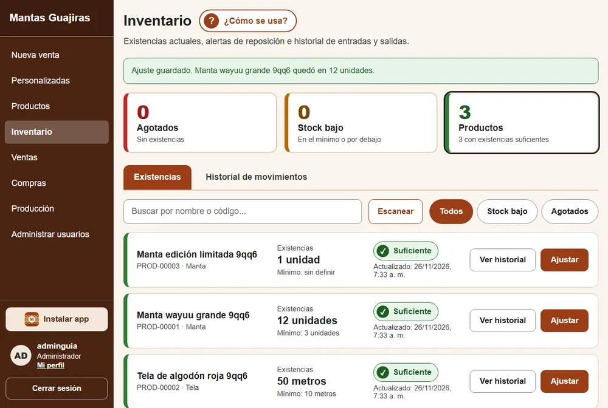

### Historial de movimientos

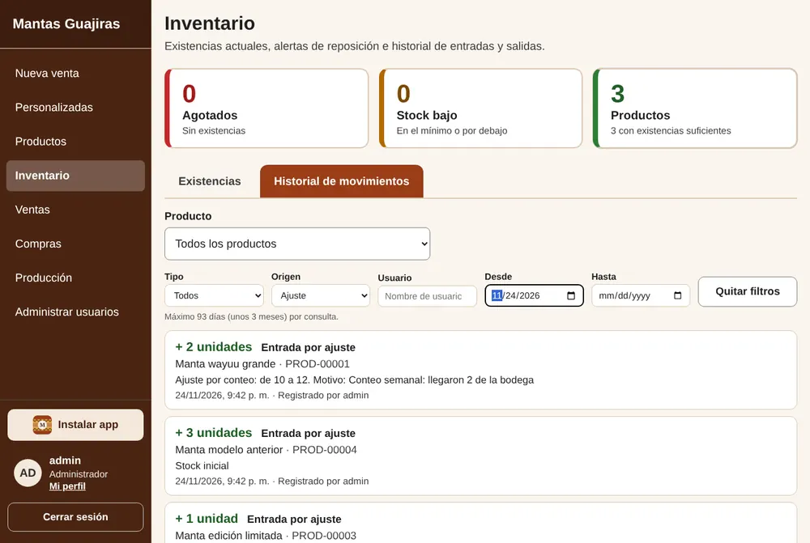

Cada entrada (+) y salida (−) queda con su origen (venta, compra, producción, personalizada o ajuste), la fecha y quién la registró. Puedes filtrar por producto, tipo, origen, usuario y fechas.

- **Sin fechas, se muestran los últimos 30 días.** Puedes consultar hasta 3 meses de una vez; para periodos más largos, consulta por partes.
- Las listas largas se muestran de a 100: al final está **"Ver más"**.

---

## 6. Producción

Cuando se fabrican mantas con tela del inventario:

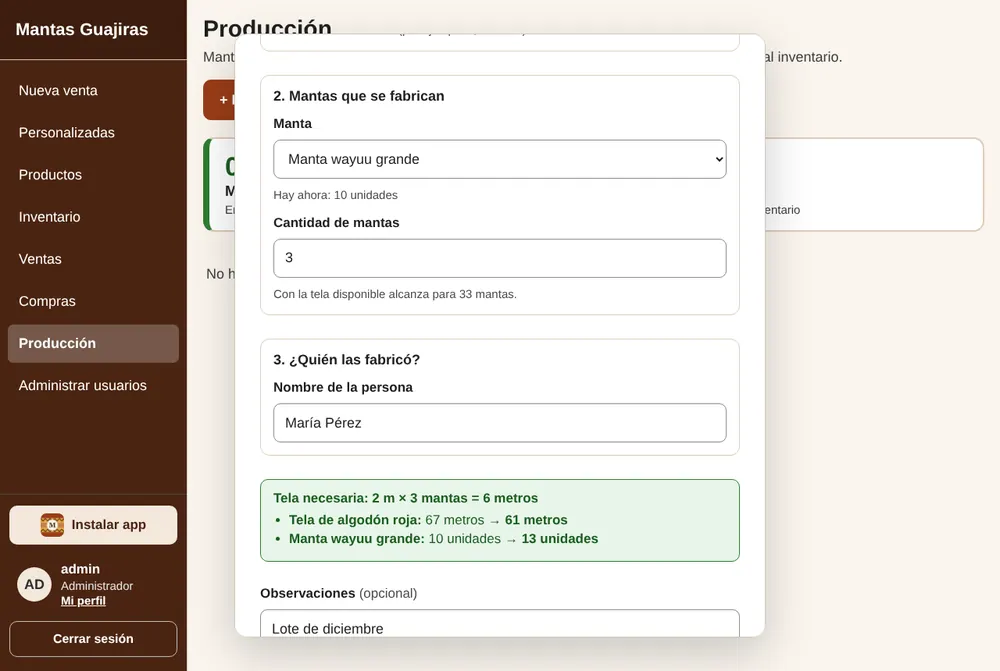

1. **+ Registrar producción**.
2. Elige la **tela** y los **metros por cada manta**.
3. Elige la **manta** que se fabrica y la **cantidad**.
4. Escribe el **nombre de la persona** que las fabricó.
5. La app muestra el cálculo: *"Tela necesaria: 2 m × 3 mantas = 6 metros"*, con cómo quedarán la tela y las mantas.
6. Pulsa **Registrar producción**. La tela baja y las mantas suben, en un solo paso.

Si no alcanza la tela, la app avisa y **no cambia nada**.

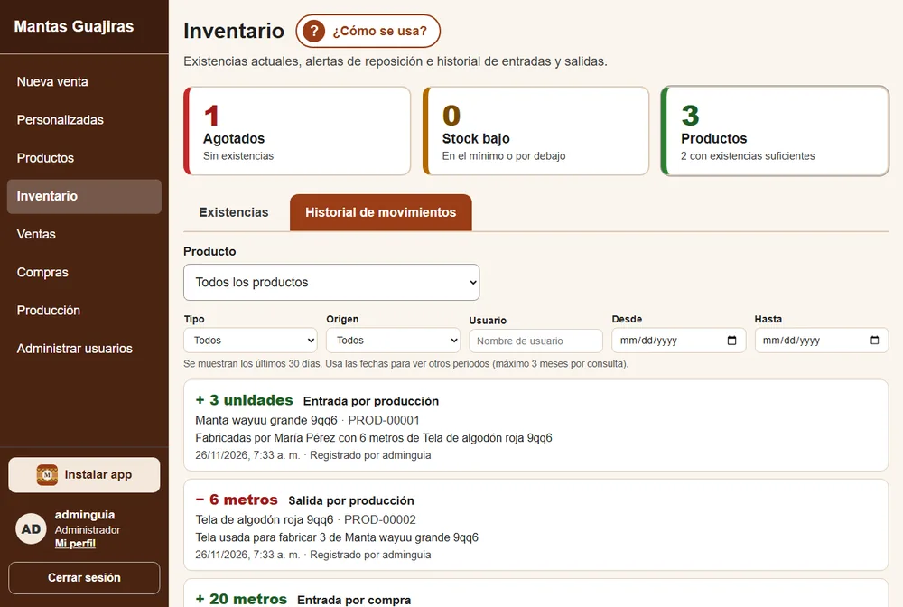

---

## 7. Mi perfil

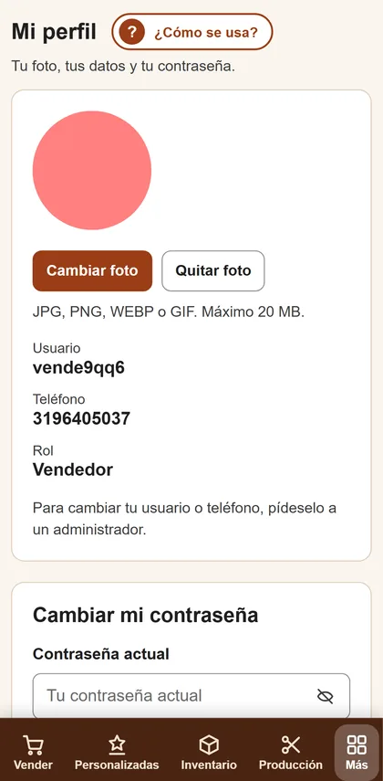

- **Subir foto / Cambiar foto / Quitar foto.** Se aceptan JPG, PNG, WEBP o GIF de hasta 20 MB. Un archivo que no sea una imagen real se rechaza, aunque su nombre termine en .png.
- **Cambiar mi contraseña:** la actual y la nueva dos veces.
- Para cambiar tu usuario o teléfono, pídeselo a un administrador.
- Al final de la página aparece la **versión de la app**. Sirve para confirmar una actualización o para reportar un problema.

---

## 8. Productos (administrador)

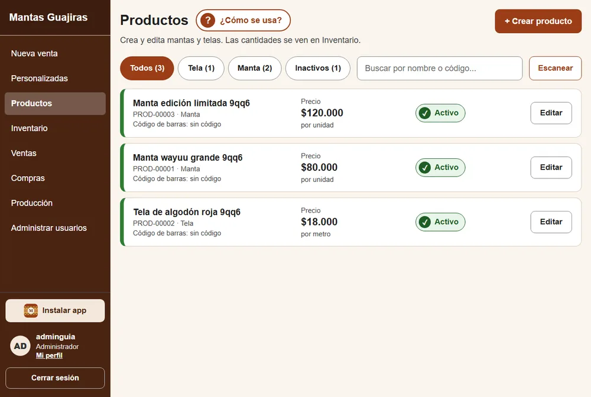

- **+ Crear producto:**
  - **Nombre.** Es único: no puede haber dos productos con el mismo nombre, sin importar mayúsculas.
  - **Categoría.** La **unidad es automática**: las mantas se cuentan por unidad (números enteros) y las telas por metros (con decimales).
  - **Precio.** Mayor que cero.
  - **Existencias iniciales** y **stock mínimo**, para la alerta de "Stock bajo".
  - Código de barras (opcional). Se puede escanear.
- **Editar** cambia nombre, precio, mínimo o código. Las ventas anteriores **conservan el precio con que se vendieron**.
- **Desactivar:** en *Editar*, quita la marca **Producto activo**. Deja de aparecer para vender, pero su historial se conserva. Se ve en el filtro **Inactivos**, desde donde se puede reactivar.

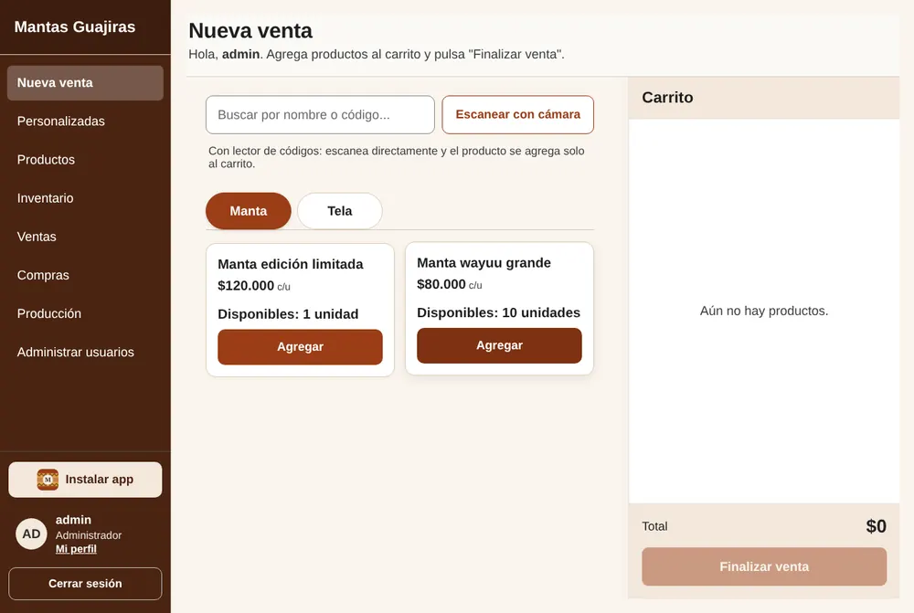

Los vendedores ven esta pantalla **solo para consultar**:

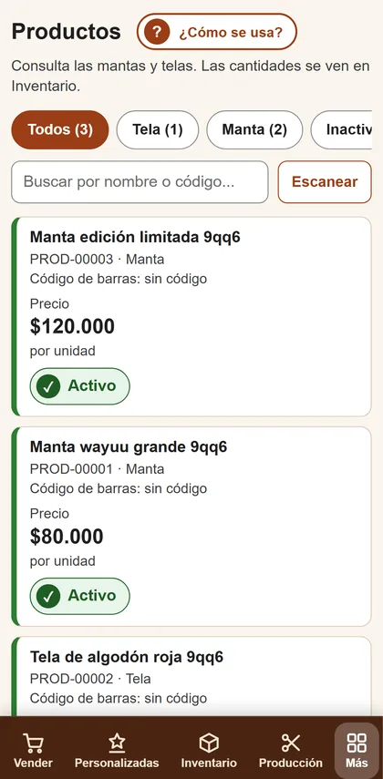

---

## 9. Historial de ventas (administrador)

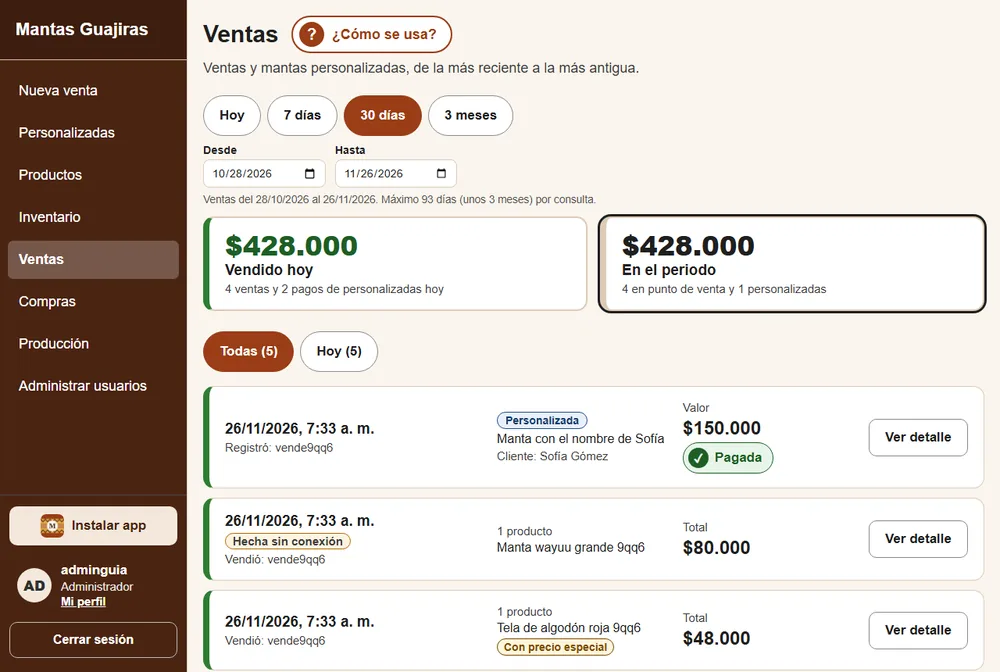

- Elige el periodo: **Hoy**, **7 días**, **30 días** (por defecto), **3 meses**, o fechas *Desde / Hasta* (máximo 3 meses por consulta).
- **Vendido hoy**: el dinero recibido hoy (ventas más pagos de personalizadas). **En el periodo**: el total de las fechas elegidas.
- Las ventas con precio especial dicen **"Con precio especial"** y las hechas sin internet, **"Hecha sin conexión"**.
- **Ver detalle** muestra cada producto, la cantidad, el precio cobrado, el precio normal con el descuento y quién vendió:

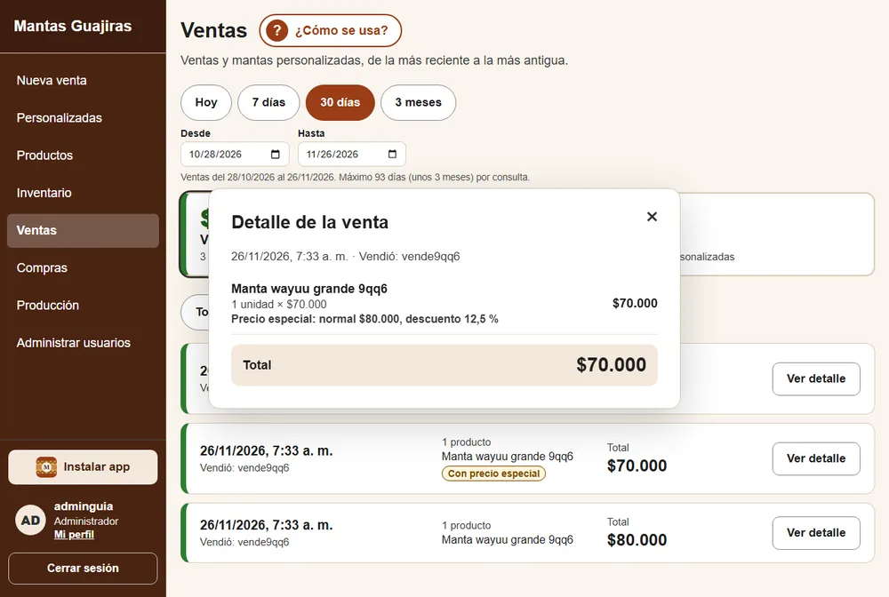

---

## 10. Compras (administrador)

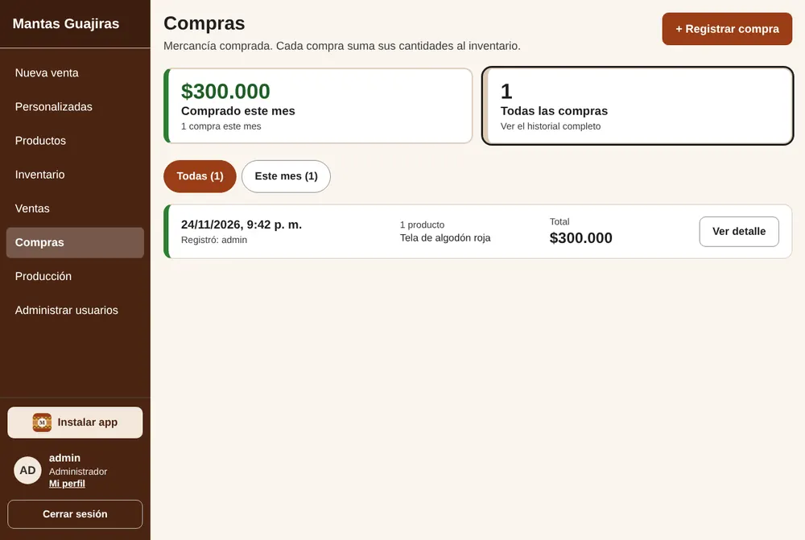

1. **+ Registrar compra**.
2. Por cada producto: cantidad y costo. Con **+ Agregar otro producto** se suman más líneas.
3. Observaciones, por ejemplo el número de factura.
4. La app muestra el total y cómo quedará el inventario.
5. Pulsa **Registrar compra**. Aparece *"Compra registrada por $300.000. Las cantidades ya se sumaron al inventario."*

Las compras no se editan ni se borran. Si hubo un error, se corrige con un ajuste de inventario con su motivo.

---

## 11. Usuarios (administrador)

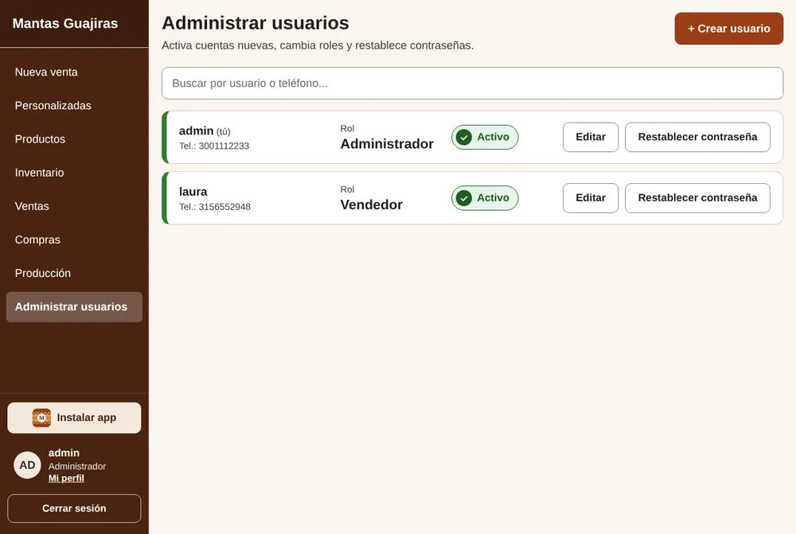

- **+ Crear usuario:** usuario (hasta 12 caracteres), teléfono, contraseña, rol (**Vendedor** o **Administrador**) y si está activo.
- **Cuentas nuevas:** quien se registra solo queda **esperando aprobación**. Aparece primero en la lista; pulsa **Activar** para darle acceso.
- **Editar:** cambiar el rol o desactivar la cuenta. Una cuenta desactivada no puede iniciar sesión, pero sus ventas y movimientos se conservan.
- **Restablecer contraseña:** cuando alguien la olvida. Dile que la cambie en *Mi perfil*.
- Siempre debe quedar **al menos un administrador activo**, y nadie puede desactivar su propia cuenta.

---

## 12. Mensajes y qué hacer

| Mensaje | Qué significa | Qué hacer |
| --- | --- | --- |
| *Vendiendo sin conexión* | No hay internet o el servidor no responde | Sigue vendiendo; las ventas se envían solas (§3) |
| *No hay suficiente inventario de … Disponible: N* | Alguien vendió o contó antes que tú | Corrige la cantidad del carrito. Si el inventario está mal, ajústalo con motivo |
| *La base de datos no responde en este momento…* | Problema momentáneo del servidor | La venta queda guardada en el dispositivo y se envía sola; avisa al administrador si dura |
| *Tu sesión expiró. Vuelve a iniciar sesión.* | Pasaron 12 horas | Vuelve a iniciar sesión. Las ventas pendientes se envían a tu nombre |
| *Demasiados intentos fallidos. Espera…* | 5 contraseñas erradas seguidas | Espera 15 minutos o pide que te restablezcan la contraseña |
| *Ya existe un producto llamado …* | Nombres repetidos no se permiten | Usa otro nombre, por ejemplo con el color o el tamaño |
| *La cantidad contada es igual a la registrada* | El ajuste no cambia nada | No hace falta ajustar |
| *Elige un periodo de máximo 93 días* | Consulta muy larga | Consulta por partes |
| *Sección restringida* | Esa pantalla es solo para administradores | — |
| *Ha ocurrido un error interno. Código de referencia: a1b2c3d4* | Falla no prevista | Anota el código y avísale al administrador: con él se encuentra el detalle (`docs/12` §6) |
